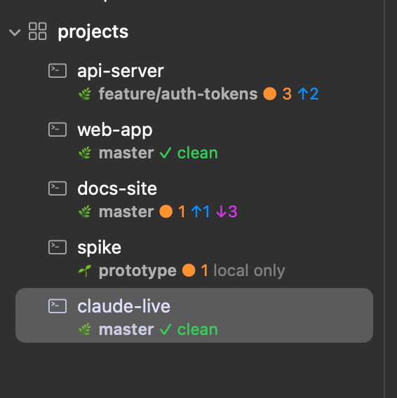

# Claude git info

Claude Code keeps the git state of the repository it works in on a line under the session's sidebar row: branch, changed files, commits ahead of and behind the upstream.

Author: [@umputun](https://github.com/umputun)



## What it does

With several agents running, the sidebar answers "which of these left uncommitted work" without visiting each session. A hook updates the line when Claude starts, after every edit or shell command, and when a turn ends:

- `🌿 master ✓ clean`: on a branch with an upstream, nothing changed.
- `🌿 feature ● 3 ↑2`: three changed or untracked files, two local commits the upstream does not have.
- `🌿 master ● 1 ↑1 ↓4`: the upstream also has four commits this branch lacks.
- `🌱 spike ● 1 local only`: a branch with no upstream configured.
- `📍 b64de22 detached ✓ clean`: a detached HEAD, shown by its commit.

The branch is bold, `✓ clean` green, the changed count orange, `↑` blue, `↓` purple and `local only` dim. The line goes away when Claude exits, and when Claude's working directory is outside git.

## Requirements

- agterm 0.40.0 or later, which shipped `session info`.
- Claude Code.
- `jq`.
- git 2.15 or later, for `--no-optional-locks`.
- bash, which macOS ships as `/bin/bash`.

## Setup

Copy the script somewhere and make it executable:

```sh
mkdir -p ~/bin
cp git-info.sh ~/bin/
chmod +x ~/bin/git-info.sh
```

Register it for four events in `~/.claude/settings.json`, alongside anything already in those arrays:

```json
{
  "hooks": {
    "SessionStart": [
      { "hooks": [{ "type": "command", "command": "~/bin/git-info.sh", "timeout": 5 }] }
    ],
    "PostToolUse": [
      {
        "matcher": "Edit|MultiEdit|Write|NotebookEdit|Bash",
        "hooks": [{ "type": "command", "command": "~/bin/git-info.sh", "timeout": 5 }]
      }
    ],
    "Stop": [
      { "hooks": [{ "type": "command", "command": "~/bin/git-info.sh", "timeout": 5 }] }
    ],
    "SessionEnd": [
      { "hooks": [{ "type": "command", "command": "~/bin/git-info.sh", "timeout": 5 }] }
    ]
  }
}
```

The hooks run beside agterm's own status hooks from **Help ▸ Install Agent Hooks…**; Claude Code runs every hook registered for an event.

Set `AGTERMCTL` to the CLI's full path if `agtermctl` is not on the `PATH` Claude Code hands its hooks.

## Usage

Nothing to press. Start Claude in a repository and the line appears; it follows the edits, commits and branch switches Claude makes.

**Settings ▸ Interface ▸ Session info** shows the line always, in the flagged view only, or never. Read it back from the tree:

```sh
agtermctl tree --json | jq -r '.result.tree.workspaces[].sessions[] | "\(.name)\t\(.info // "-")"'
```

## How it works

One script handles every event. It reads `hook_event_name` and `cwd` from the hook's JSON input, runs `git status --porcelain=v2 --branch` once in that directory, and turns the branch header and entry lines into one `agtermctl session info --markdown` call. SessionEnd, and a directory outside git, send `--clear` instead.

- **The index lock.** A plain `git status` can take `index.lock` to refresh the index, and a `git commit` Claude runs at the same moment then fails with "index.lock exists". `--no-optional-locks` keeps the read off the lock.
- **After the tool, not before.** PreToolUse would read the tree as it was before the edit, so the refresh is on PostToolUse.
- **Synchronous.** A refresh moved into the background can finish after SessionEnd's clear and bring the line back, so every update runs inline. One `git status` and one `agtermctl` call take tens of milliseconds, and the `timeout` in the settings bounds a hung CLI.
- **Expiry.** Every set passes `--hide-after 86400`, the longest the API allows, so a Claude killed before SessionEnd still leaves no line behind past a day.
- **Branch names are escaped.** Git allows backticks, underscores and closing brackets in a branch name, which would otherwise open a code span or break the markup; every character that could open markup is backslash-escaped before the name goes into the markup, and a name over 60 characters is cut.
- **Headless runs stay out.** A `claude -p` started from a session inherits its `AGTERM_*` variables and would overwrite the line with its own directory. Claude Code sets `CLAUDE_CODE_ENTRYPOINT` to `cli` only for the agent in the pane, and the hook exits on anything else.
- **The socket.** `agtermctl` does not read `AGTERM_SOCKET` itself, so the hook passes it as `--socket`, which addresses the agterm instance the session belongs to.

Everything fails open and prints nothing: a missing `jq` or `agtermctl`, or a closed socket, costs the update and nothing else. Silence matters for SessionStart in particular, whose output Claude Code adds to the model's context.

## Limits

Nothing destructive: the hook only sets and clears its own session's info line.

- The line is a snapshot from the last hook, not a live view. A commit or branch switch you make by hand in another terminal shows only after Claude's next edit, command or turn end.
- An idle session's line expires after 24 hours, even while Claude is still running. Claude's next edit, command or turn end brings it back.
- A Claude killed hard, with no SessionEnd, leaves its last snapshot for up to 24 hours, or until the next Claude in that session replaces it. Closing the session drops it.
- Ahead and behind compare against the upstream as of the last fetch, not the remote's live state.
- The line belongs to the session, not to a pane. Two Claudes in one session's split write the same line, and the one that ran a hook last wins.
- Any other caller of `session info` on the same session overwrites, and is overwritten by, this hook.
- The headless guard depends on `CLAUDE_CODE_ENTRYPOINT`. A Claude Code too old to set it lets a `claude -p` overwrite its spawner's line.
